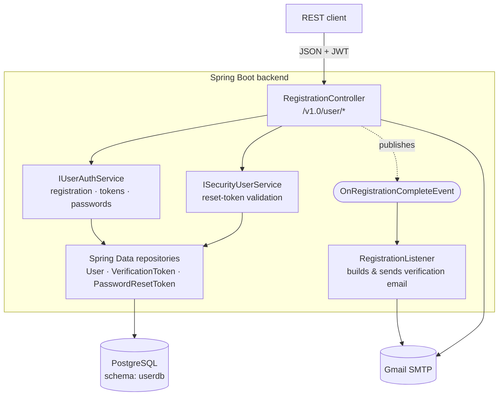
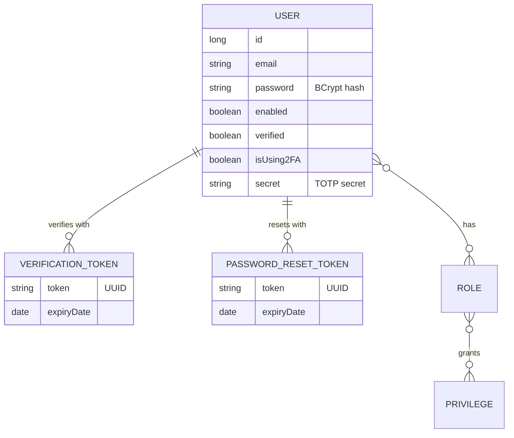
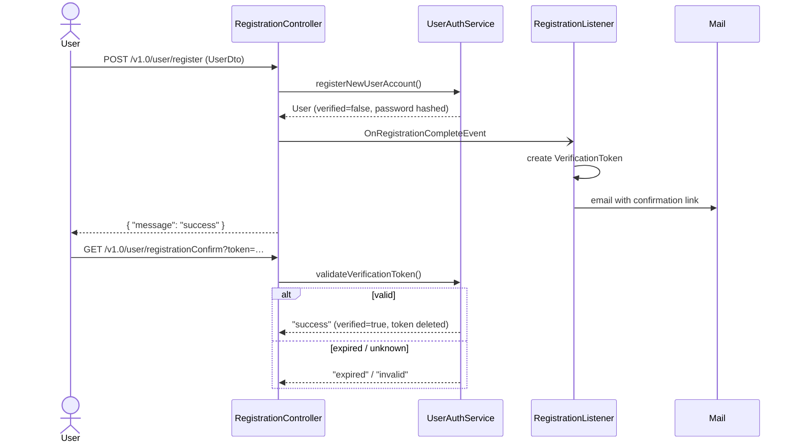
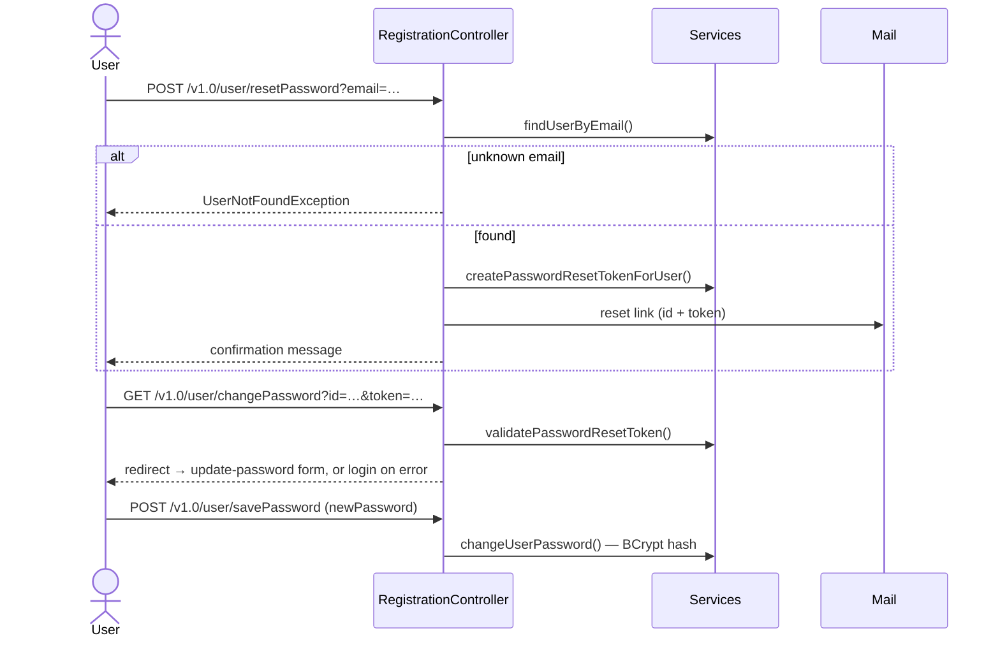
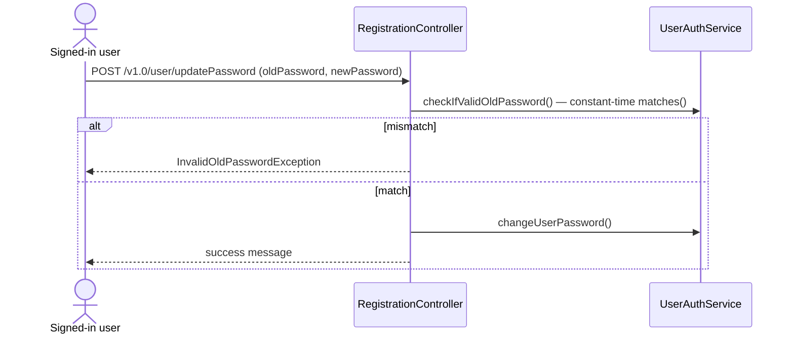

<div align="center">

# 🧮 Arithmetic Calculator — Backend

**A Spring Boot REST API with a full account-security lifecycle:**
registration with email verification, password reset, password update and optional 2FA.


[Features](#-features) ·
[Architecture](#-architecture) ·
[Workflows](#-workflows) ·
[API](#-api-reference) ·
[Getting started](#-getting-started) ·
[Testing](#-testing) ·
[Roadmap](#-roadmap)

</div>

---

## ✨ Features

| | Feature | Details |
|---|---|---|
| 📝 | **Registration** | New accounts are created with `verified = false`, and a verification email is sent automatically |
| ✉️ | **Email verification** | Each verification link holds a single-use UUID token. A valid link sets `verified = true` and deletes the token |
| 🔁 | **Resend verification** | Issuing a new token invalidates the previous one |
| 🔑 | **Password reset** | A reset link carries the user ID and a time-limited token |
| 🔒 | **Password update** | Signed-in users must confirm their current password first |
| 🛡️ | **Secure hashing** | BCrypt through Spring Security's `PasswordEncoder`, with constant-time `matches()` comparison |
| 📱 | **Two-factor auth** | Optional TOTP (AeroGear OTP). Enabling it returns a QR-code URL |
| 🌍 | **Login notifications** | Request metadata from MaxMind GeoIP2 and UA-Parser |

---

## 🏗 Architecture



**Stack:** Spring Boot 2.7.18 · Spring Security · JJWT 0.12.5 · Passay · Spring Data JPA · Flyway · PostgreSQL (H2 for tests) · SpringFox Swagger 2 · Lombok

**Base package:** `com.mycorp.arithmeticcalculator`. It contains `controller`, `service`, `security`, `domain`, `dto`, `repository`, `validators`, `error`, `handler`, `filter` and `task`.

### Core domain



---

## 🔄 Workflows

### Registration & email verification



### Password reset



### Authenticated password update



---

## 📡 API reference

All account endpoints live under **`/v1.0/user`**. Interactive docs: **`/swagger-ui.html`** (SpringFox).

| Method | Endpoint | Access | Purpose |
|---|---|---|---|
| `POST` | `/register` | public | Create an account (JSON `UserDto`) and send the verification email |
| `GET` | `/registrationConfirm?token=` | ⚠️ see [known gaps](#%EF%B8%8F-known-gaps) | Verify the email address |
| `GET` | `/resendRegistrationToken?token=` | public | Replace an old verification token and email the new one |
| `POST` | `/resetPassword?email=` | public | Email a password-reset link |
| `GET` | `/changePassword?id=&token=` | public | Validate a reset token and redirect |
| `POST` | `/savePassword` | `READ_PRIVILEGE` | Set a new password after a reset |
| `POST` | `/updatePassword` | `READ_PRIVILEGE` | Change password (requires the old one) |
| `POST` | `/update/2fa?use2FA=` | signed-in user | Toggle 2FA; returns a QR-code URL when enabling |

Other API groups: `POST /v1.0/login` (JWT), `/v1.0/users/**` and `/v1.0/roles/**` (admin), `/v1.0/images/**` (avatars).

Responses use a simple envelope:

```json
{ "message": "success" }
```

| Exception | Meaning |
|---|---|
| `UserAlreadyExistsException` | Email is already registered |
| `UserNotFoundException` | No account for the email given to `/resetPassword` |
| `InvalidOldPasswordException` | The current password didn't match on `/updatePassword` |

---

## 🚀 Getting started

Commands below run from `calculator-backend/`.

### Prerequisites

- **JDK 21.** The compiler targets `release 16`, so don't use Java 17+ language features.
- **Docker** for PostgreSQL.
- **Lombok annotation processing** enabled in your IDE.

### 1 · Start the database

```bash
cp ../docker/.env.template ../docker/.env      # then fill in real values
cd ../docker && docker-compose up -d app-db
```

> Start only `app-db`. `app-backend` depends on a Redis service that is commented out, so a plain `up -d` fails.

### 2 · Build & run

```bash
./mvnw clean package                              # build the jar
SPRING_PROFILES_ACTIVE=dev ./mvnw spring-boot:run # run on http://localhost:8080
```

> Use `spring-boot:run` rather than `java -jar`. The GeoIP database is loaded with `ResourceUtils.getFile(...)`, which fails inside a packaged jar.

> ⚠️ `spring.jpa.hibernate.ddl-auto=create`: **the schema is dropped and recreated on every startup.** Flyway migrations (`src/main/resources/db/migration`) run first, then Hibernate recreates the entity tables.

### Configuration

| Variable | Purpose |
|---|---|
| `SPRING_PROFILES_ACTIVE` | `dev` (local Postgres), `docker`, `test` (H2). With no profile, the app falls back to embedded H2 |
| `SPRING_DATASOURCE_URL` / `_USERNAME` / `_PASSWORD` | Database override. The `dev` default is `postgres` / `passw0rd` |
| `SPRING_MAIL_USERNAME` / `SPRING_MAIL_PASSWORD` | Gmail SMTP credentials for verification and reset emails |
| `support.email` | Sender address (property in `application*.properties`) |

---

## 🧪 Testing

```bash
./mvnw spotless:check    # formatting (Eclipse formatter)
./mvnw spotless:apply    # fix formatting
./mvnw test              # unit, property-style, integration and REST Assured tests
./mvnw test -Dtest=ClassName
```

Tests use an embedded H2 database (`TestDbConfig`), so no Postgres is needed. Flyway is disabled for tests through `src/test/resources/test-db.properties`.

Each core **correctness property** has its own test class. For example:

| Property | Test |
|---|---|
| 1 · Registration creates unverified user | `RegistrationCreatesUnverifiedUserPropertyTest` |
| 2 · Verification token round-trip | `VerificationTokenRoundTripPropertyTest` |
| 3 · Expired verification tokens are rejected | `ExpiredVerificationTokenPropertyTest` |
| 4 · New token invalidates old token | `NewVerificationTokenInvalidatesOldTokenPropertyTest` |
| 5 · Verification tokens expire after 60 min | `VerificationTokenExpiryPropertyTest` ❌ |
| 8 · Password reset token validation | `PasswordResetTokenValidationPropertyTest` |
| 9 · Expired reset tokens are rejected | `ExpiredPasswordResetTokenPropertyTest` |

> These tests are JUnit loops over many generated inputs. jqwik is declared in the pom but not used yet.

---

## 🗺 Roadmap

- [x] Domain entities, DTOs and custom exceptions
- [x] Registration, verification-token issue / validate / resend
- [x] Password-reset token creation and validation
- [x] Property tests for properties 1–5, 8 and 9
- [ ] Password management verified against the spec (task 5)
- [ ] Email service: `@Async` delivery and failure logging (task 6)
- [ ] Controller endpoint verification (task 7)
- [ ] Deny unverified users access to protected resources (task 9)
- [ ] Configurable reset-token expiry (task 10)
- [ ] End-to-end workflow integration tests (task 12)

## ⚠️ Known gaps

The code currently differs from the intended behavior in these places:

| Area | Intended | Current code |
|---|---|---|
| Verification token lifetime | 60 minutes | `VerificationToken.EXPIRATION = 60 * 24` (24 h). That's why `VerificationTokenExpiryPropertyTest` fails |
| Public confirm route | `/v1.0/user/registrationConfirm` | `SecSecurityConfig` permits `/v1.0/registrationConfirm`, so the real endpoint requires authentication |
| Email links | point at the API endpoints | the verification link targets `/registrationConfirm.html` and the reset link targets `/user/changePassword` (no `/v1.0` prefix) |
| Async email | `@Async` sending | sending is synchronous. There is no `@Async` or `@EnableAsync` |
| Unverified users | denied access | `verified` is stored but not enforced |
| JWT key | n/a | regenerated on every startup, so tokens don't survive a restart |
