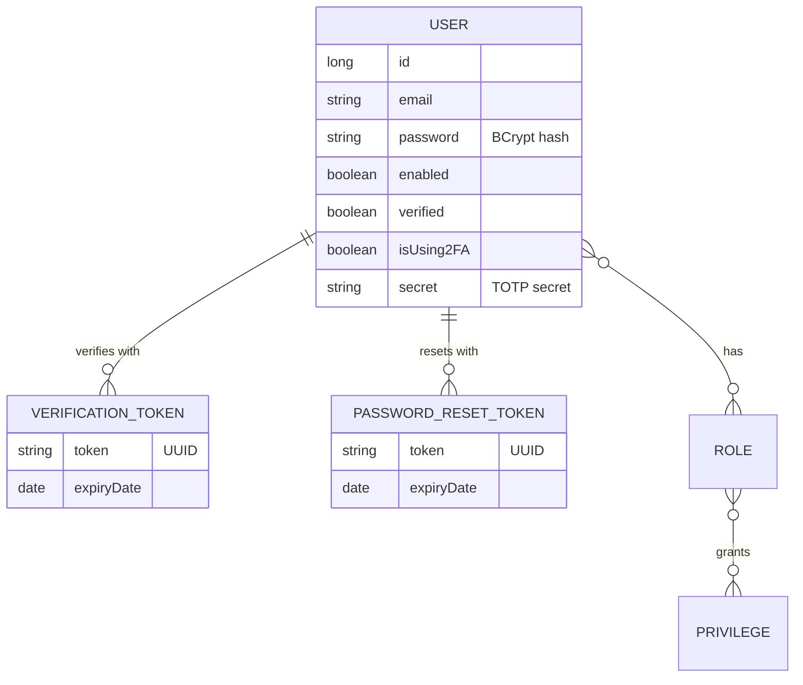
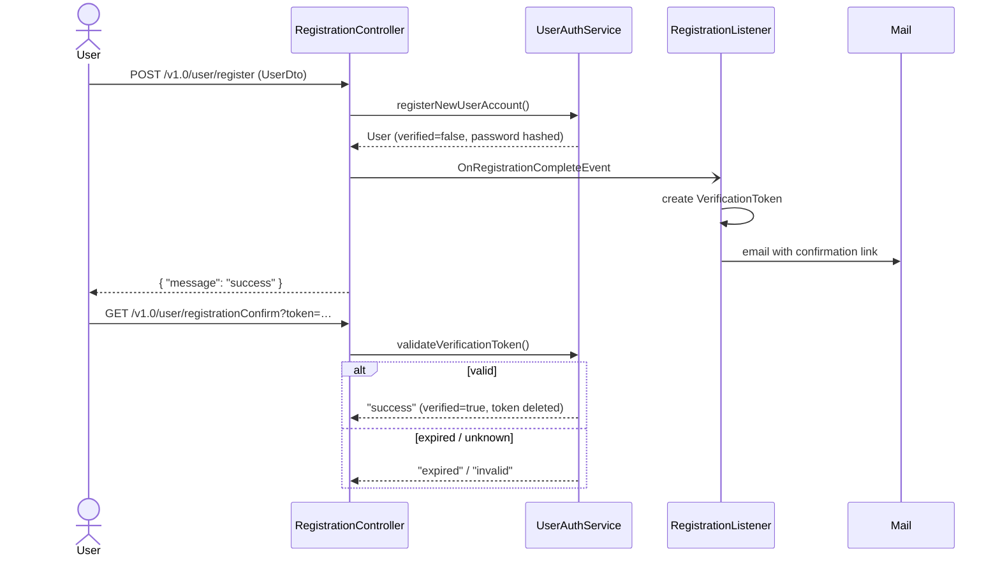
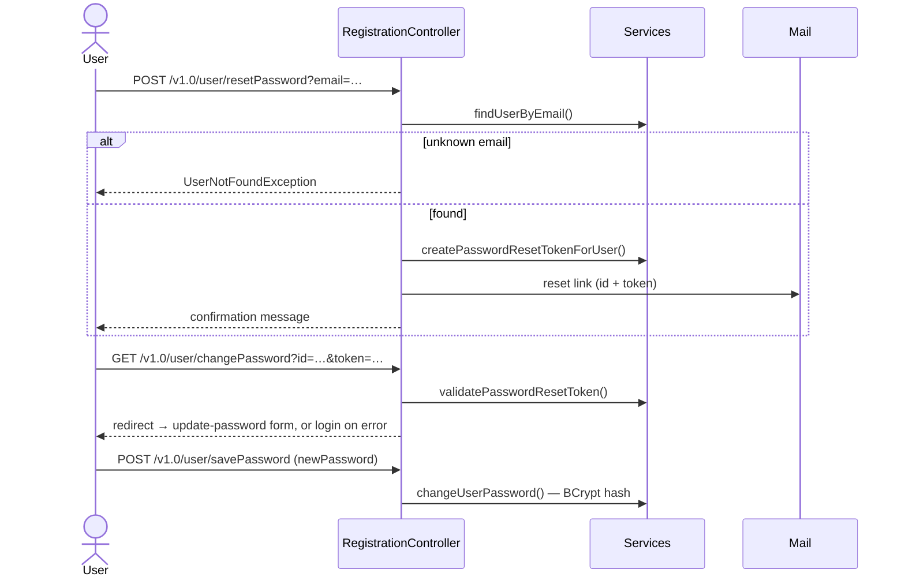
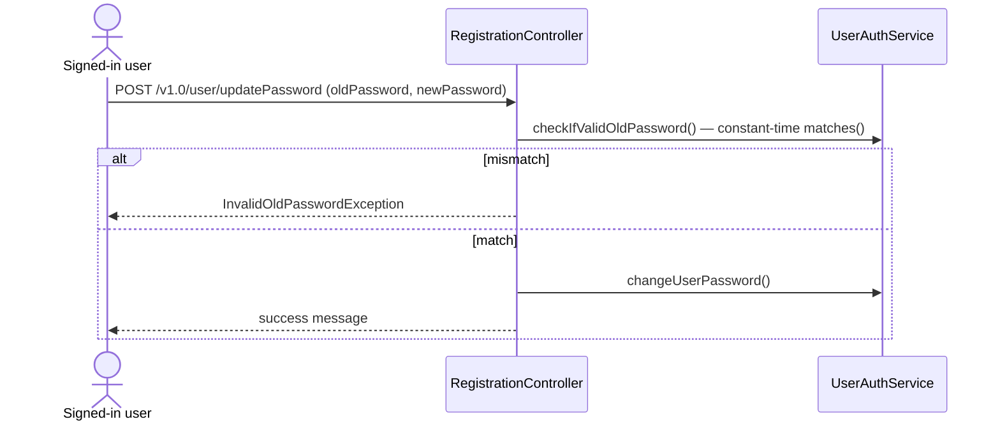

<div align="center">

# 🧮 Arithmetic Calculator — Backend

**A Spring Boot REST API with a full account-security lifecycle:**
registration with email verification, password reset, password update and optional 2FA.


[Features](#-features) ·
[Architecture](#-architecture) ·
[Workflows](#-workflows) ·
[API](#-api-reference) ·
[Getting started](#-getting-started) ·
[Testing](#-testing) ·
[Roadmap](#-roadmap)

</div>

---

## ✨ Features

| | Feature | Details |
|---|---|---|
| 📝 | **Registration** | New accounts are created with `verified = false`, and a verification email is sent automatically |
| ✉️ | **Email verification** | Each verification link holds a single-use UUID token. A valid link sets `verified = true` and deletes the token |
| 🔁 | **Resend verification** | Issuing a new token invalidates the previous one |
| 🔑 | **Password reset** | A reset link carries the user ID and a time-limited token |
| 🔒 | **Password update** | Signed-in users must confirm their current password first |
| 🛡️ | **Secure hashing** | BCrypt through Spring Security's `PasswordEncoder`, with constant-time `matches()` comparison |
| 📱 | **Two-factor auth** | Optional TOTP (AeroGear OTP). Enabling it returns a QR-code URL |
| 🌍 | **Login notifications** | Request metadata from MaxMind GeoIP2 and UA-Parser |

---

## 🏗 Architecture


**Stack:** Spring Boot 2.7.18 · Spring Security · JJWT 0.12.5 · Passay · Spring Data JPA · Flyway · PostgreSQL (H2 for tests) · SpringFox Swagger 2 · Lombok

**Base package:** `com.mycorp.arithmeticcalculator`. It contains `controller`, `service`, `security`, `domain`, `dto`, `repository`, `validators`, `error`, `handler`, `filter` and `task`.

### Core domain



---

## 🔄 Workflows

### Registration & email verification



### Password reset



### Authenticated password update



---

## 📡 API reference

Interactive docs: **`/swagger-ui.html`** (SpringFox). The API is stateless: get a token from `/v1.0/login`, then send it on every request as `Authorization: Bearer <token>`.

**Access:** 🌐 public · 🔑 any signed-in user · 👤 `ROLE_USER` or `ROLE_ADMIN` · 🛡️ `ROLE_ADMIN` only. Access rules come from `SecSecurityConfig` and `@PreAuthorize`. All successful responses are `200 OK`. ⚠️ marks an endpoint that doesn't currently work as intended; see [known gaps](#%EF%B8%8F-known-gaps).

### Authentication

| Method | Endpoint | Access | Input | Response |
|---|---|---|---|---|
| `POST` | `/v1.0/login` | 🌐 | JSON `LoginRequest` `{ email, password }` | `LoginResponse` `{ login, token }`. Bad credentials → `503` |

### Registration & passwords: `/v1.0/user`

| Method | Endpoint | Access | Input | Response |
|---|---|---|---|---|
| `POST` | `/register` | 🌐 | JSON `UserDto` `{ firstName, lastName, email, password, matchingPassword, isUsing2FA, role }` | `{ message: "success" }`, and sends the verification email |
| `GET` | `/registrationConfirm` | 🔑 ⚠️ | `?token=` | `{ message: "success" \| "expired" \| "invalid" }` |
| `GET` | `/resendRegistrationToken` | 🌐 | `?token=` (the old token) | Confirmation message, and emails a new token |
| `POST` | `/resetPassword` | 🌐 | `?email=` | Confirmation message, and emails a reset link. Unknown email → `404` |
| `GET` | `/changePassword` | 🌐 ⚠️ | `?id=&token=` | Should redirect to the update form, or to login on an invalid token |
| `POST` | `/savePassword` | ⚠️ | form params `newPassword` | Success message |
| `POST` | `/updatePassword` | ⚠️ | form params `oldPassword`, `newPassword` | Success message. Wrong old password → `400` |
| `POST` | `/update/2fa` | 🔑 | `?use2FA=true\|false` | QR-code URL when enabling, `"Success"` when disabling |

### User administration: `/v1.0/users`

| Method | Endpoint | Access | Input | Response |
|---|---|---|---|---|
| `GET` | `/v1.0/users` | 🛡️ | `?page=0&size=10&sortBy=id&sortOrder=ASC` | Page of `UserResponce`. The `login` parameter is accepted but ignored |
| `GET` | `/v1.0/users/by-name/{name}` | 👤 | path `name` | `UserResponce` |
| `POST` | `/v1.0/users` | 🛡️ | JSON `UserResponce` | Created `UserResponce` |
| `PUT` | `/v1.0/users` | 🛡️ | JSON `UserResponce` | Empty `200` |
| `DELETE` | `/v1.0/users/{userId}` | 🛡️ | path `userId` | Empty `200` |
| `GET` | `/v1.0/users/email-check` | 🛡️ | `?email=` | Uniqueness result (string) |
| `GET` | `/v1.0/users/login-check` | 🛡️ | `?username=` | Uniqueness result (string) |

### Roles: `/v1.0/roles`

| Method | Endpoint | Access | Input | Response |
|---|---|---|---|---|
| `GET` | `/v1.0/roles` | 🛡️ | none | List of `RoleDto` `{ id, role, description, privileges }` |
| `POST` | `/v1.0/roles` | 🛡️ | JSON `RoleDto` | Created `RoleDto` |
| `PUT` | `/v1.0/roles/v1.0/roles` | 🛡️ ⚠️ | JSON `RoleDto` | Always `404` (not implemented) |
| `DELETE` | `/v1.0/roles/{roleId}` | 🛡️ | path `roleId` | Empty `200`. Unknown role → `404` |

### Images: `/v1.0/images`

| Method | Endpoint | Access | Input | Response |
|---|---|---|---|---|
| `GET` | `/v1.0/images/{imageId}` | 👤 | path `imageId` | Image bytes. Falls back to the default image |
| `GET` | `/v1.0/images/default` | 👤 | none | Default background image, or `404` |
| `POST` | `/v1.0/images` | 🛡️ | multipart `file` | New image ID (string) |

### Sessions: `/api/users`

| Method | Endpoint | Access | Input | Response |
|---|---|---|---|---|
| `GET` | `/api/users/loggedUsers` | 🔑 | none | Usernames from the active-user store |
| `GET` | `/api/users/loggedUsersFromSessionRegistry` | 🔑 | none | Users from the session registry |
| `GET` | `/api/users/{userId}` | 🔑 | path `userId` | User data |

### Errors

Message endpoints return a `GenericResponse` envelope, `{ "message": "…", "error": "…" }`. `RestResponseEntityExceptionHandler` maps exceptions to status codes:

| Exception | Status |
|---|---|
| Validation errors (`ConstraintViolationException`, invalid `@Valid` bodies) | `400` |
| `InvalidOldPasswordException` | `400` |
| `UserNotFoundException`, `RoleNotFoundException` | `404` |
| `UserAlreadyExistException` | `409` |
| `BadCredentialsException` | `503` |
| Anything else | `500` |

---

## 🚀 Getting started

Commands below run from `calculator-backend/`.

### Prerequisites

- **JDK 21.** The compiler targets `release 16`, so don't use Java 17+ language features.
- **Docker** for PostgreSQL.
- **Lombok annotation processing** enabled in your IDE.

### 1 · Start the database

```bash
cp ../docker/.env.template ../docker/.env      # then fill in real values
cd ../docker && docker-compose up -d app-db
```

> Start only `app-db`. `app-backend` depends on a Redis service that is commented out, so a plain `up -d` fails.

### 2 · Build & run

```bash
./mvnw clean package                              # build the jar
SPRING_PROFILES_ACTIVE=dev ./mvnw spring-boot:run # run on http://localhost:8080
```

> Use `spring-boot:run` rather than `java -jar`. The GeoIP database is loaded with `ResourceUtils.getFile(...)`, which fails inside a packaged jar.

> ⚠️ `spring.jpa.hibernate.ddl-auto=create`: **the schema is dropped and recreated on every startup.** Flyway migrations (`src/main/resources/db/migration`) run first, then Hibernate recreates the entity tables.

### Configuration

| Variable | Purpose |
|---|---|
| `SPRING_PROFILES_ACTIVE` | `dev` (local Postgres), `docker`, `test` (H2). With no profile, the app falls back to embedded H2 |
| `SPRING_DATASOURCE_URL` / `_USERNAME` / `_PASSWORD` | Database override. The `dev` default is `postgres` / `passw0rd` |
| `SPRING_MAIL_USERNAME` / `SPRING_MAIL_PASSWORD` | Gmail SMTP credentials for verification and reset emails |
| `support.email` | Sender address (property in `application*.properties`) |

---

## 🧪 Testing

```bash
./mvnw spotless:check    # formatting (Eclipse formatter)
./mvnw spotless:apply    # fix formatting
./mvnw test              # unit, property-style, integration and REST Assured tests
./mvnw test -Dtest=ClassName
```

Tests use an embedded H2 database (`TestDbConfig`), so no Postgres is needed. Flyway is disabled for tests through `src/test/resources/test-db.properties`.

Each core **correctness property** has its own test class. For example:

| Property | Test |
|---|---|
| 1 · Registration creates unverified user | `RegistrationCreatesUnverifiedUserPropertyTest` |
| 2 · Verification token round-trip | `VerificationTokenRoundTripPropertyTest` |
| 3 · Expired verification tokens are rejected | `ExpiredVerificationTokenPropertyTest` |
| 4 · New token invalidates old token | `NewVerificationTokenInvalidatesOldTokenPropertyTest` |
| 5 · Verification tokens expire after 60 min | `VerificationTokenExpiryPropertyTest` ❌ |
| 8 · Password reset token validation | `PasswordResetTokenValidationPropertyTest` |
| 9 · Expired reset tokens are rejected | `ExpiredPasswordResetTokenPropertyTest` |

> These tests are JUnit loops over many generated inputs. jqwik is declared in the pom but not used yet.

---

## 🗺 Roadmap

- [x] Domain entities, DTOs and custom exceptions
- [x] Registration, verification-token issue / validate / resend
- [x] Password-reset token creation and validation
- [x] Property tests for properties 1–5, 8 and 9
- [ ] Password management verified against the spec (task 5)
- [ ] Email service: `@Async` delivery and failure logging (task 6)
- [ ] Controller endpoint verification (task 7)
- [ ] Deny unverified users access to protected resources (task 9)
- [ ] Configurable reset-token expiry (task 10)
- [ ] End-to-end workflow integration tests (task 12)

## ⚠️ Known gaps

The code currently differs from the intended behavior in these places:

| Area | Intended | Current code |
|---|---|---|
| Verification token lifetime | 60 minutes | `VerificationToken.EXPIRATION = 60 * 24` (24 h). That's why `VerificationTokenExpiryPropertyTest` fails |
| Public confirm route | `/v1.0/user/registrationConfirm` | `SecSecurityConfig` permits `/v1.0/registrationConfirm`, so the real endpoint requires authentication |
| Email links | point at the API endpoints | the verification link targets `/registrationConfirm.html` and the reset link targets `/user/changePassword` (no `/v1.0` prefix) |
| Async email | `@Async` sending | sending is synchronous. There is no `@Async` or `@EnableAsync` |
| Unverified users | denied access | `verified` is stored but not enforced |
| `savePassword` / `updatePassword` | available to signed-in users | `@PreAuthorize("hasRole('READ_PRIVILEGE')")` requires the authority `ROLE_READ_PRIVILEGE`, but users only get their role names (`ROLE_USER`, `ROLE_ADMIN`). Both endpoints always return `403` |
| `savePassword` principal | current user | casts the security principal to the domain `User`, but the JWT filter sets a Spring Security `User`, so it would fail with a `ClassCastException` |
| `changePassword` redirect | HTTP redirect | the controller is a `@RestController`, so `"redirect:/…"` is sent back as plain text instead of a redirect |
| Role update | `PUT /v1.0/roles` | the method mapping repeats the class prefix (`/v1.0/roles/v1.0/roles`), and the method is a stub that always returns `404` |
| `/loggedUsers` admin rule | admin-only | `SecSecurityConfig` protects `/loggedUsers`, but the endpoint is `/api/users/loggedUsers`, so any signed-in user can call it |
| JWT key | n/a | regenerated on every startup, so tokens don't survive a restart |
